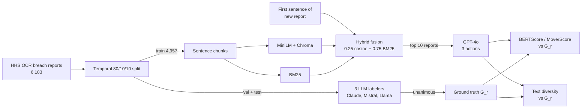

# EMBER: RAG-Based Corrective Action Recommendation for HIPAA Breaches

Code for the paper *EMBER: RAG-Based Corrective Action Recommendation for
HIPAA Breaches* (Vishnu Kalaparty, Hui Guo, Munindar P. Singh, Vaibhav Garg;
under review).

Given the opening sentence of a new HHS breach report, EMBER retrieves similar
past breach reports with a hybrid BM25 + dense retriever and asks GPT-4o for
three corrective actions grounded in those reports.



## Results

Test set, 599 reports, hybrid MiniLM with α = 0.25 and k = 10 (Table I):

| Precision | Recall | F1 | MoverScore |
|---:|---:|---:|---:|
| 0.9010 | 0.8872 | **0.8939** | 0.8660 |

Text diversity of EMBER's actions against the ground truth (Table II):

| Metric | EMBER | G_r | Δ | Wass. | JS |
|---|---:|---:|---:|---:|---:|
| CR | 10.60 | 13.26 | −2.66 | | |
| CR:POS | 10.68 | 13.64 | −2.96 | | |
| NGD | 0.699 | 0.445 | +0.254 | | |
| SRS (n=4) | 7.11 | 7.67 | −0.56 | 0.562 | 0.121 |
| Leave-one-out Self-BLEU | 0.200 | 0.224 | −0.024 | 0.033 | 0.147 |
| Intra-set Self-BLEU | 0.072 | 0.056 | +0.017 | 0.017 | 0.223 |

The JSON files behind every reported number are in [`results/`](results).

## Layout

```
pipeline/
  config.py        every path, model name, prompt and hyperparameter
  data_prep/       load the HHS export, temporal stratified split, numbered sentences
  labeling/        Claude / Mistral / Llama labelers and the unanimous-agreement rule
  vp_extraction/   spaCy verb phrases (sets the output depth of 3)
  rag/             Chroma (MiniLM, OpenAI) and BM25 indexes, hybrid fusion, GPT-4o
  eval/            hyperparameter search, test scoring, diversity, corpus stats
results/           result files for the paper's tables
data/bad_verbs.csv stop list of non-remediation verbs
```

## Setup

```bash
python3 -m venv .venv
.venv/bin/pip install -r requirements.txt
.venv/bin/python -m spacy download en_core_web_lg
cp .env.example .env   # add your API keys
```

Download the breach report export from the
[HHS OCR breach portal](https://ocrportal.hhs.gov/ocr/breach/breach_report.jsf)
and save it as `data/breach_report_202509.csv` (the paper uses the export
accessed on 17 September 2025).

## Reproducing the paper

Run every command from the repo root with `.venv/bin/python -m ...`.

**Data and ground truth (§III-A, §III-B)**

```bash
python -m pipeline.data_prep.split_data              # 80/10/10 temporal split
python -m pipeline.data_prep.build_report_sentences  # numbered sentences (val + test)
python -m pipeline.labeling.claude_batch submit      # then: status, fetch
python -m pipeline.labeling.mistral_batch submit     # then: status, fetch
python -m pipeline.labeling.llama_openrouter run
python -m pipeline.labeling.aggregate_labels         # unanimous agreement -> G_r
python -m pipeline.eval.sentence_gr                  # sentence-level G_r
python -m pipeline.vp_extraction.spacy_extract       # verb phrases per G_r
```

**Indexes (§III-C)**

```bash
python -m pipeline.rag.index                     # MiniLM Chroma index, train split only
python -m pipeline.rag.openai_embed train        # OpenAI embedder for Stage 1
python -m pipeline.rag.bm25_index
```

**Hyperparameter search on validation (§III-E, §IV-A)**

Generation runs through the OpenAI Batch API (three actions per report).

```bash
python -m pipeline.eval.batch_rag submit --split val --stage 1   # then: status, fetch
python -m pipeline.eval.sweep_val_hybrid_stage1                  # embedder x alpha at k=10
python -m pipeline.eval.batch_rag submit --split val --stage 2   # then: status, fetch
python -m pipeline.eval.sweep_val_hybrid_stage2                  # k in {5, 10, 15, 20}
```

**Test set (§IV-B, §IV-C)**

```bash
python -m pipeline.eval.batch_rag submit --split test --frozen   # then: status, fetch
python -m pipeline.eval.run_hybrid_minilm_a025_k10_test           # Table I
python -m pipeline.eval.run_diversity_rag_vs_gr                   # Table II
python -m pipeline.eval.compute_diversity_distribution_metrics    # Wass. and JS
python -m pipeline.eval.corpus_stats                              # median verb phrases per G_r
```

## License

MIT. See [LICENSE](LICENSE).
